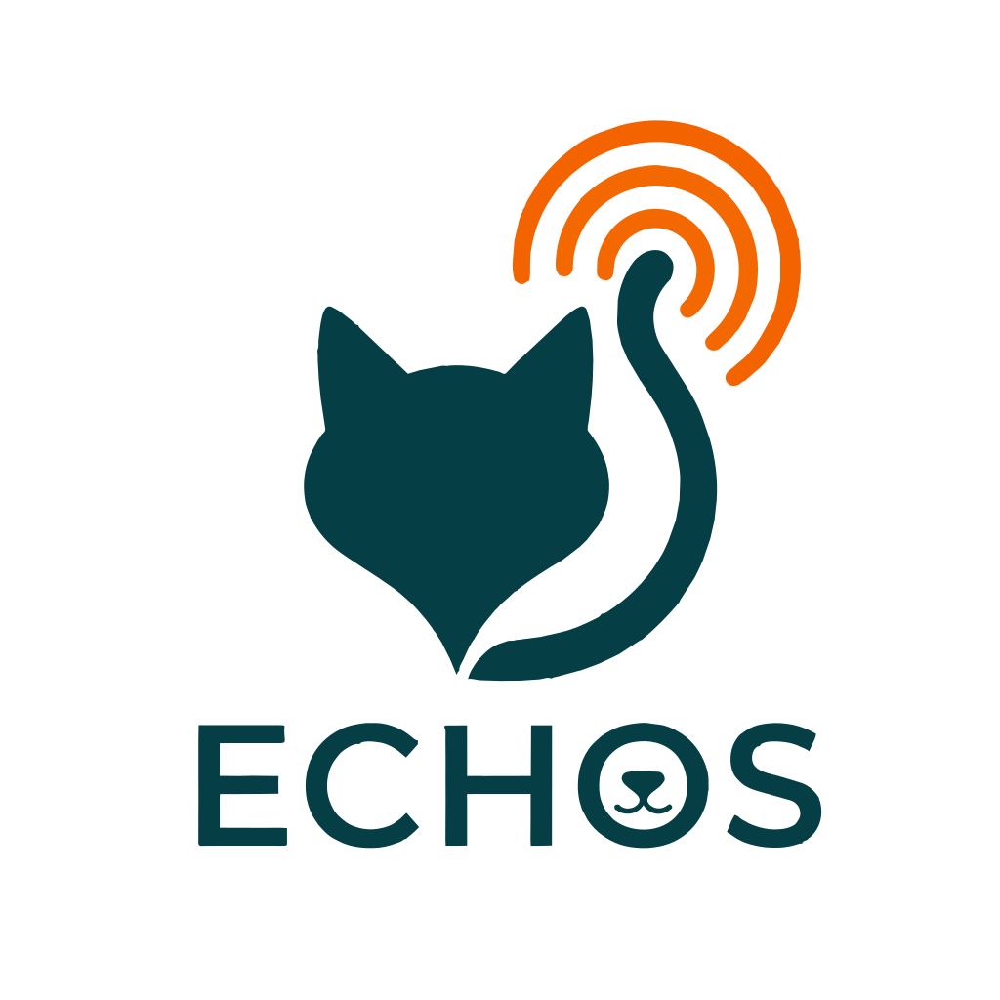
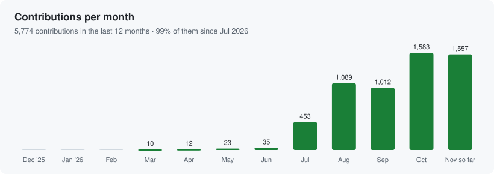

# Hi, I'm Tarkan 👋

I'm a solo builder from İstanbul. I build software for animals and the people who look after them, and I make small mobile games on the side.

## 🔢 Under the hood

<table>
  <tr>
    <td align="center" width="33%"><h3>2 products · 4 apps</h3>Echos (web + mobile), Echos Asistan and an admin app, all on one Supabase/Postgres database</td>
    <td align="center" width="33%"><h3>~14,000</h3>automated tests unit · widget · integration · end-to-end</td>
    <td align="center" width="33%"><h3>574</h3>database migrations</td>
  </tr>
  <tr>
    <td align="center"><h3>~400k</h3>lines of Dart and TypeScript</td>
    <td align="center"><h3>400+</h3>written design decisions</td>
    <td align="center"><h3>3,600+</h3>commits since June 2026</td>
  </tr>
</table>

## 🐾 Echos

<picture>
  <source media="(prefers-color-scheme: dark)" srcset="assets/echos-logo-dark.svg" />
  
</picture>

**A neighbourhood radar that reunites lost and found pets and street animals with the people looking for them.**

- **Lost & found:** post a lost or found animal and nearby people get notified.
- **Adoption:** a separate module for finding animals a home.

Web, Android and iOS from one Supabase/Postgres backend. Free, no ads.

🌐 **Try it:** [echos.com.tr](https://www.echos.com.tr)

## 🩺 Echos Asistan

<picture>
  <source media="(prefers-color-scheme: dark)" srcset="assets/asistan-logo-dark.svg" />
  
</picture>

**A companion app for the pet you already have,** from the same Echos account.

- **Health record:** vaccines, treatments, parasite care and vet visits in one place.
- **Calendar & reminders:** upcoming vaccines and doses, so nothing is missed.
- **Food & expenses:** track meals and what you spend on your pet.
- **Vets:** save your clinics, book visits and reach an emergency screen fast.
- **QR tag:** a tag on the collar; whoever finds your pet scans it and reaches you.

Coming soon to Google Play · iOS next.

## 🎮 Games

| Game | What it is | Built with | Status |
|---|---|---|---|
| **Clockword** | A word and trivia game across the ages: era questions, letter-tile hints | Flutter | 🟢 Active · Android testing |
| **Öte** *(working title)* | An AI-powered mobile RPG with a creature that hatches from your personality | Godot 4 · Claude | 🟡 Prototypes |
| **Yuva** *(working title)* | A no-combat AI virtual pet that grows, talks and passes on to the next generation | Godot 4 · Claude | 🟡 Early prototype |
| **Rune Master** *(working title)* | One-handed roguelite rune puzzle: draw runes, place them on a spell circle, discover spells | Godot 4 | ⏸️ Prototype, on hold |
| **Pocket Roots** | Turn-based hex island puzzle: restore barren islands and prepare for natural crises | Godot 4 | ⏸️ Prototype, on hold |

## 🛠️ Tech I use

  

## 📈 Activity

Most of my work lives in private repositories, so these numbers say more than my public repo list.

<picture>
  <source media="(prefers-color-scheme: dark)" srcset="assets/aylik-katki-koyu.svg" />
  
</picture>

  

---

🇹🇷 Türkçe

Merhaba, ben Tarkan. İstanbul'dan, hayvanlar ve onlara bakan insanlar için yazılım geliştiriyorum. **Echos**, kayıp ve bulunan sokak ve evcil hayvanları mahalle mahalle buluşturan ücretsiz ve reklamsız bir radar. **Echos Asistan** ise sahiplendiğin dostun için: sağlık karnesi, aşı takvimi ve hatırlatmalar, mama ve gider defteri, veterinerlerin ve QR künyesi. Boş zamanlarımda küçük mobil oyunlar yapıyorum.

🌐 [echos.com.tr](https://www.echos.com.tr)

